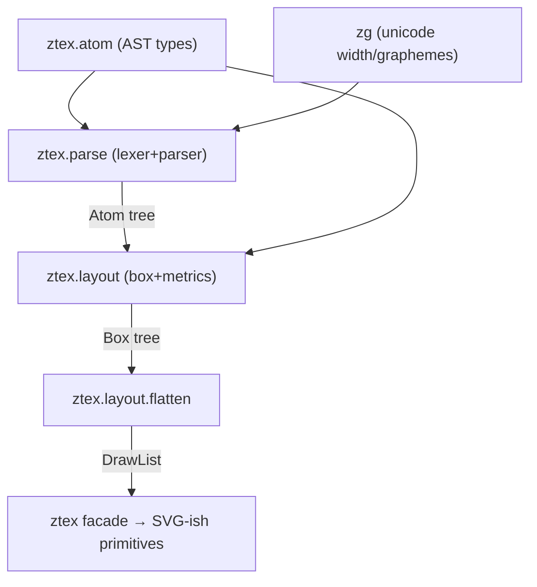

# ztex — architecture

LaTeX math: **parse** + **layout** in Zig. Minimal, self-contained, each stage
usable separately. Output is an **SVG-style draw list** (backend-neutral list
of primitives) — render backends are out of scope. Speed is a first-class
requirement: single-pass, arena-allocated, zero string rewriting.

Source of inspiration: `~/projects/MicroTeX` (C++ port of jlatexmath). See
`notes/microtex-map.md` for the reference map. We keep its clean seams and box
model; we drop its string-replacement parser, XML config, dynamic registration,
and platform backends.

## Principles

- **One arena, one pass.** Parse + layout + flatten allocate from a single
  arena. Bulk-free at the end. No per-node malloc/free, no per-char copies.
- **No string rewriting.** MicroTeX rewrites the source string for scripts and
  macros. We tokenize once and drive a recursive-descent parser — O(n).
- **Shared contract = the atom tree.** `parse` produces atoms; `layout`
  consumes atoms + metrics and produces a box tree; `flatten` walks boxes into
  a draw list. Each stage is a pure function of its inputs.
- **Deterministic.** Same input → same draw list. No hash-order, no globals.

## Module graph (each independently testable / importable)



- **`ztex.atom`** — shared AST types (the parse↔layout contract). No deps.
- **`ztex.parse`** — source `[]const u8` → atom tree. Tokenizer + recursive
  descent. Uses zg for grapheme-aware `\text{}` measurement.
- **`ztex.layout`** — atom tree + `FontMetrics` → box tree, then `flatten` →
  `DrawList`. The draw list is the terminal, priority artifact.
- **`ztex`** — facade: `ztex.parse(latex) → DrawList`.

## Parse layer (`src/parse/`)

```
lexer.zig    source → []Token   (char, \command, { }, ^ _ , comment, utf-8)
parser.zig   []Token → Atom     (recursive descent, groups, scripts, \frac, \text, space)
atom.zig     Atom = union(char|group|script|fraction|space|text)
root.zig     parse(gpa, src) !Atom
```

Parser rules come from MicroTeX's grammar (escapes, `{}` groups, `^`/`_`
scripts, optional args `[ ]`, primitives `\frac`, `\sqrt`, `\text`, spaces).
We expand macros (`\newcommand`) by rewriting the **token stream**, never the
source string.

## Layout layer (`src/layout/`)

```
box.zig      Box = union(hbox|vbox|char|glue|strut|rule)  + dims w/h/depth/shift
metrics.zig  FontMetrics interface (glyph dims + italic corr; glue params)
layout.zig   Atom + FontMetrics + style → Box (TeX glue algorithm)
draw.zig     Draw = union(text|rect|line) + DrawList + flatten(box,x,y)   ★
root.zig     layout(gpa, atom, metrics, style) !Box
```

Classic TeX box model (from MicroTeX): every box carries `width/height/depth/
shift`; `glue` is the only stretchable/shrinkable primitive; `strut` is
invisible (metrics only). `flatten` walks the box tree in painter's order,
emitting absolute-coordinate primitives — directly SVG-shaped.

## Draw list (top priority)

```zig
Draw = union(enum) {
    text: Text,   // glyph run: text, x, y (baseline), size, font, color
    rect: Rect,   // filled rect (rules, fraction bars, radicals, matrix borders)
    line: Line,   // stroked line (decorations)
};
DrawList = struct { arena, items: []Draw };
```

Painter's order, absolute coords, no nested transforms — flat, trivial to emit
as `<text>`/`<rect>`/`<line>` or feed any backend.

## Font metrics — key open decision

TeX layout needs per-glyph width/height/depth + italic correction, plus glue
params (axis height, big-op spacing). Two options:

1. **Bundled static table** (recommended first): Computer-Modern-style numbers
   compiled into Zig data. Deterministic, zero runtime cost, self-contained.
   Match MicroTeX's bundled-metrics model.
2. **OpenType MATH via harfbuzz** (later): real metrics from a math TTF, behind
   the same `FontMetrics` interface. Adds harfbuzz dep; enables arbitrary fonts.

Start with (1) behind `FontMetrics` so (2) is a drop-in swap. zg gives text
width/grapheme iteration for `\text{}`; harfbuzz is deferred until real
shaping / MATH is needed.

## Performance workflow

- **Arena + no copies** is the baseline design.
- `zig build bench` runs the benchmark harness (see `src/bench/`): parse +
  layout + flatten over a corpus, wall + alloc counts. Track regressions.
- Tools in devenv: `hyperfine` (CLI timing), `valgrind` (mem), `perf-tools`
  (profiling). Benchmarks are part of CI-like verification, not an afterthought.
- Hot paths to keep allocation-free: tokenizer (slice cursor over source),
  metrics lookup (static table, no hashing).

## Performance — implemented (first pass)

- **Superflat** atom tree + box pool: one arena, no pointers, contiguous
  child runs. Parse + layout + flatten are single passes.
- **Provenance** is free: token spans are byte offsets; atom → box → drawable
  all carry spans (no extra table).
- **SIMD lexer fast path**: `scanUntilStructural` jumps printable runs to the
  next structural byte (see `notes/research-fast-parse.md`); differential-tested.
- `zig build bench` baseline: ≈ 8 µs/formula, ≈ 12 drawables/formula at
  20 pt ReleaseFast on this laptop. Re-baseline with `-Dcpu=native` to unlock
  AVX2/512 (default target is baseline SSE only).


## File layout

```
src/
├── root.zig          facade: parse(latex) → DrawList
├── atom.zig          AST types (shared contract)
├── parse/{root,lexer,parser}.zig
├── layout/{root,box,metrics,draw}.zig
└── bench/            benchmark harness (zig build bench)
```
