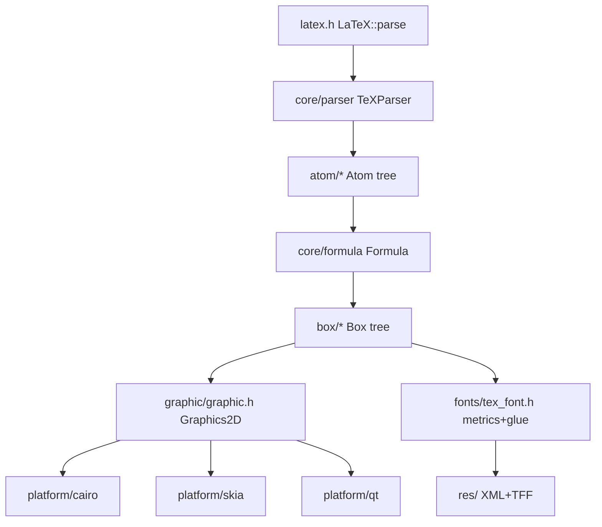

# MicroTeX — reference mental map

Clone: `~/projects/MicroTeX` (upstream NanoMichael/MicroTeX, v0.0.1-321-g0e3707f).
C++17 port of Java *jlatexmath*. MIT (fonts/XML under `res/` are separately licensed).

## Pipeline (classic Knuth TeX)

```
LaTeX::parse(tex, width, textSize, lineSpace, fg)
   │
   ▼
TeXParser (core/parser.*)        tokenize + preprocess
   │  → atom tree (AST)
   ▼
Formula (core/formula.*)          owns root Atom; holds symbol/macro maps
   │
   ▼
Atom::createBox(Environment)      (atom/*)
   │  TeX layout rules + glue metrics from TeXFont
   ▼
Box tree (box/*)                  HBox/VBox/CharBox/GlueBox/StrutBox/RuleBox/OverBar
   │  w/h/depth/shift/type; only GlueBox stretches/shrinks
   ▼
Box::draw(Graphics2D, x, y)       box tree walks into drawing ops
   │
   ▼
platform/{cairo,skia,qt,gdi}      concrete Graphics2D backends
```

## Layers

| Layer | Dir | Role |
|---|---|---|
| Entry | `latex.h`, `render.h` | `LaTeX::parse` or `Formula`+`TeXRenderBuilder` |
| Parse | `core/parser.*`, `core/macro.*` | tokenize LaTeX, expand `\newcommand`/macros, build atoms |
| Atom (AST) | `atom/*` | Char, Row, Fraction, Matrix, Space, … semantic nodes |
| Box (layout) | `box/*`, `box_factory.*` | atoms → laid-out boxes with fixed metrics |
| Font metrics | `fonts/tex_font.h`, `fonts/font_info.*` | per-glyph w/h/d + italic corr; glue params (axis height, big-op spacing); alphabet→font mapping |
| Graphic (backend) | `graphic/graphic.h` | abstract `Graphics2D`, `Font`, `TextLayout` interfaces |
| Platform | `platform/` | cairo, skia, qt, gdi_win |
| Resources | `res/` | bundled font metrics (XML) + TTF fonts + symbol/macro maps |
| Utils | `utils/` | utf, string_utils, dict_tree, enums |

## Things worth stealing for ztex

- **Separation**: parser produces a semantic atom tree; layout is a pure function
  atom tree + font metrics → box tree. Clean seams → "usable separately".
- **Box model**: `Box{width,height,depth,shift,type}`; `BoxGroup` children;
  `GlueBox` is the single stretchable/shrinkable primitive. Well-understood.
- **Metrics are bundled, not queried**: per-glyph metrics + glue params live in
  data files. Deterministic, self-contained. (Caveat: C-Modern fonts only.)
- **Weak line-breaking**: project itself says text layout is weak — delegate
  long text to a text shaper; ztex is for math.

## Things to drop / do differently in ztex

- No platform backends. Layout output is a **draw list** (SVG-style list of
  primitives), not a `draw(g2)` walk.
- No XML config / dynamic registration. Zig compile-time data.
- No `dynamic_cast`, no refcounted `sptr`, no global static mutable state —
  Tiger style: explicit allocator, tagged unions, arena per render.
- jlatexmath/MicroTeX parser is string-replacement based and slow; we can do a
  proper tokenizer + recursive-descent parser.

## Module codegraph


